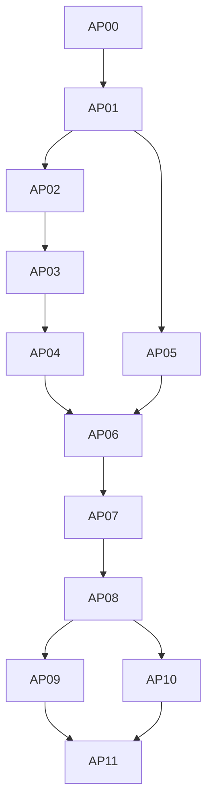

# 04 – Implementierungsplan: Rhythmusinformation analysieren und erzeugen

Stand: 10. Oktober 2026. Planungsbasis: Specs-Commit `839711b` auf
`docs/rhythm-information-specs/VR-9`; geprüfte Produktionscodebasis `a22e024`.
Dieses Dokument plant die Umsetzung. Es implementiert keine Befehle und
ändert keine Vikunja-Tickets.

Das Ergebnis ist ein eigener CLI-Bereich **`syrincs rhythm-info`** für die
exakte Analyse, Erzeugung und Rekonstruktion nach `description-v1`.
Bestehende Endpunkte bleiben mit ihrer bisherigen Bedeutung verfügbar.
Die neuen Funktionen brauchen weder Datenbank noch Audiohardware.

Fachliche Quellen bleiben [M01–M07](01-mass-und-beschreibung.md),
[A01–A04, G01–G06 und S01–S03](02-analyse-und-generierung.md),
[Prüffälle P01–P09](03-prueffaelle-und-abnahme.md) und die
[numerischen Fixtures](fixtures-description-v1.json). Der Plan konkretisiert
deren Implementierung; Grammatik, Kosten und Beispielwerte werden nicht
neu festgelegt. Die einzige Anpassung des bisherigen Bedienungsentwurfs
ist der ausdrücklich gewünschte neue Befehlsbereich, nachgezogen in S02.

## 1. Umfang und Schutz der bestehenden Endpunkte

Mit »Endpunkt« ist hier ein Picocli-Unterbefehl gemeint. Syrincs erhält
durch diesen Plan keinen HTTP-Server.

| Bestehender Endpunkt | Geschützter Vertrag |
| --- | --- |
| `analyze rhythm` einschließlich `--details` | Bisheriges Huffman-/Automatenmaß, Codesymbolzahlen, Zustandsfortführung, Validierung und Ausgabe. |
| `calculate rhythms` und Alias `calculate rhythm` | Bestehende Erzeugung von 65.536 Einzeltakten und bisherige Persistenz. |
| `search rhythms` | Bisherige Bedeutung von `--info`, Deviation-, Beat-Profil- und Peak-Filtern, Deduplizierung und Sortierung. |
| `play rhythm` / `play rhythm info` | Bestehende RDL-/Katalogbedienung, Auswahl, MIDI-Mapping, Geräteauflösung und Defaults. |
| Akkordbefehle, `devices`, `init`, `start`, `status` | Bestehende Syntax, Verhalten und Konfigurationsauflösung. |
| Historische Kurzformen, Aliasse und versteckte Befehle | Bestehende Sichtbarkeit und Bedeutung. |

Es werden keine neuen Bitwerte in alte `info`-/`deviation`-Spalten
geschrieben. Auch das bestehende `Rhythm`-Objekt und der alte
`UseCaseInteractor` werden nicht auf die neue Semantik umgestellt.
Neue Optionen für Maß, Scope oder Generierung gehören ausschließlich zum
neuen Bereich. Eine spätere Integration in Playback oder Persistenz
erhält eigene Endpunkte und einen gesonderten Auftrag.

Notwendige additive Integrationsänderungen sind die Registrierung des
neuen Bereichs in `RootCmd`, seine Verdrahtung in `Main`, zusätzliche
Root-Hilfe und Completion. Die vollständige Root-Hilfe wächst dadurch;
die bisherigen Blattbefehle behalten ihre Optionen und Ausgaben.

## 2. Öffentlicher Bedienungsvertrag

Alle folgenden Befehle sind **geplante Syntax**. Sie werden erst mit den
zugehörigen Arbeitspaketen ausführbar. Für textuelle Zahlen und Flags
werden gemeinsame Converter ausschließlich im neuen CLI-Paket verwendet.

### 2.1 Gemeinsame Eingaben und Ausgabe

| Option / Eingabe | Vertrag |
| --- | --- |
| `--measure description-v1` | Default im neuen Bereich; zunächst die einzige neue Maßversion. Unbekannte Versionen ergeben einen Eingabefehler. |
| `--scope global\|isolated\|causal` | Default `global`; Abbildung auf `GLOBAL_DESCRIPTION`, `ISOLATED_WINDOWS`, `CAUSAL_WINDOWS`. |
| `--window-slots K` oder `--boundaries 0,...,N` | Für lokale Scopes genau eine vollständige Partition. Gleich große Fenster verlangen Teilbarkeit; keine Auffüllung. Im globalen Scope nicht zulässig. |
| `--history ONSETS` | Optionaler tatsächlicher Vorlauf, nur für `causal`; Default leer. Dasselbe Raster wie die Zielphrase. |
| `--bar-slots B` | Optionale vollständige Takteinteilung lokaler Profile; Taktgrenzen müssen Fenstergrenzen sein. Keine automatische Annahme von 16 Positionen. |
| `--tempo BPM` zusammen mit `--ticks-per-quarter R` | Positive rationale Viertel-BPM und positives ganzzahliges Raster. Gemeinsam anzugeben. |
| `--slot-duration-ms Q` | Alternative direkte positive rationale Rasterdauer; schließt die Tempo-/Rasteroptionen aus. Ohne Zeitoptionen ist Zeit `UNKNOWN`. |
| `--time-signature Z/N` | Optionale Notationsangabe mit Tempo-/Rasterrahmen. Taktlänge `Z·4·R/N` muss ganzzahlig sein; vorhandene Taktgrenzen müssen dazu passen. Liefert keine automatisch gehörte Referenz. |
| `--references FILE` | JSON mit expliziten metrischen Referenzen und ihrer Herkunft; keine freie Beat-Erkennung. |
| `--reference-profile london-time-window-v1` | Optionales benanntes partielles Zeitprofil; keine vollständige Prüfung aller metrischen Wohlgeformtheitsbedingungen. |
| `--format text\|json` | Default `text`; JSON schreibt genau ein versioniertes Ergebnisdokument auf stdout. Diagnosen gehen auf stderr. |
| `--request FILE` | Vollständige versionierte JSON-Anfrage als Alternative zu positionalem Inhalt und fachlichen Flags. Nur Anzeigeoptionen dürfen zusätzlich gesetzt werden. |

Rationale Eingaben erlauben endliche Dezimalzahlen und Brüche wie `1/4`.
Sie werden exakt normalisiert; `NaN`, Unendlich und Nulldenominator sind
ungültig. Positionen in Ereignisbedingungen und Segmentgrenzen sind
nullbasiert, Profil-Peaks einbasiert. Die Hilfe nennt diese Unterschiede.
Onsets verwenden `x`/`o`; RDL-`-` wird nicht automatisch übersetzt.

Der neue Rahmen hat **keinen impliziten Zeit-, Beat- oder Taktdefault**.
Die Default-Werte der bestehenden Endpunkte bleiben davon unberührt.
`--bar-slots` bezeichnet eine explizite Gruppierung von Profilfenstern,
keine zusätzliche aktive metrische Aufmerksamkeitsebene.

### 2.2 Neuer Endpunkt `rhythm-info analyze`

Die Eingabe ist genau ein Onset-Wort oder eine JSON-Anfrage. Die Länge
wird aus dem normalisierten Wort ermittelt; in JSON muss eine zusätzlich
angegebene Rahmenlänge damit übereinstimmen. Unterstützt werden 1 bis
128 Positionen. JSON kann alternativ exakte Ereigniszeitpunkte mit einem
expliziten Rasterrahmen liefern; der Eingabeadapter muss M02 ohne
Quantisierung, Zusammenlegung doppelter Ereignisse oder Toleranz erfüllen.

Zusätzliche Anzeigeoptionen:

- `--include-global`: bei lokaler Primäranalyse zusätzlich das globale
  Minimum mit eigenem Messschlüssel zeigen;
- `--compare-legacy`: bei kompatiblem 4/4-/Vierer-Raster zusätzlich die
  vorhandene Analyse unter `CODE_SYMBOLS` zeigen; inkompatible Rahmen
  erhalten `UNAVAILABLE` mit Grund;
- `--alternatives-limit K`: positive Begrenzung ausgegebener optimaler
  Beschreibungen, Default 10. Gesamtzahl und Minimalitätsnachweis bleiben
  vollständig; die Grenze kürzt nur die Ansicht.

```bash
syrincs rhythm-info analyze "xooo xooo xooo xooo" --format json
syrincs rhythm-info analyze "xooo xooo xooo xooo" \
  --scope causal --window-slots 4 --bar-slots 16 --include-global
syrincs rhythm-info analyze "xooo xooo xooo xooo" \
  --tempo 108 --ticks-per-quarter 4 --time-signature 4/4
```

Die erste Eingabe liefert global 13 Bits mit Code `0110110101000`.
Die zweite liefert bei leerem Vorlauf das kausale Profil `[8,8,3,3]`,
`continuationTotal=22` und gesondert das globale Minimum 13. Die dritte
behält global 13 Bits, weist aber eine Rasterdauer von `1250/9` ms aus.
Ohne Referenz wird dadurch keine Referenzprüfung als bestanden erklärt.

### 2.3 Neuer Endpunkt `rhythm-info generate`

Pflichtangaben sind Länge, Zielwert/-bereich und Suchstrategie.
`--slots N` verlangt 1 bis 128. Entweder `--info I` oder gemeinsam
`--info-min A --info-max B` definiert den inklusiven Primärzielbereich.
Im globalen Scope wird D, im isolierten Scope `isolatedTotal`, im kausalen
Scope `continuationTotal` gefiltert. Ein unbenanntes Gemisch ist unzulässig.

| Option | Vertrag |
| --- | --- |
| `--strategy exhaustive\|code-length\|random` | Explizit erforderlich; keine heimliche Wahl anhand der Länge. Exhaustive ist in V1 auf N≤16 begrenzt. |
| `--attempt-budget K` | Positives Zählbudget für `code-length` und `random`; bei `exhaustive` nicht erlaubt. |
| `--limit K` | Positive angefragte Ergebniszahl, Default 20. Bei systematischer Suche ausschließlich Ausgabelimit; bei `random` zugleich zulässiges Abbruchziel. |
| `--selection first\|random-without-replacement` | Default `first`. Zufallsauswahl verlangt einen vollständig bekannten Trefferbestand; `random` als Suchstrategie erlaubt nur `first`. |
| `--seed LONG` | Erforderlich für Zufallsgenerierung oder Zufallsauswahl; bei rein deterministischer Suche ohne Zufallsauswahl nicht erlaubt. |
| `--onset-min A`, `--onset-max B` | Inklusive ganzzahlige Grenzen in 0..N. |
| `--density-min Q`, `--density-max Q` | Inklusive rationale Dichte in 0..1; exakte Umrechnung in zulässige Einsatzanzahlen. |
| `--required-positions CSV`, `--forbidden-positions CSV` | Mengen in 0..N−1 ohne Überschneidung. |
| `--min-onset-gap K` | Positive ganzzahlige lineare Einsatzdistanz. Keine implizite zyklische Randbedingung. |
| `--max-zero-run K` | Maximale Folge ohne neue Einsätze einschließlich der Ränder; K in 0..N. |
| `--window-profile CSV`, `--bar-profile CSV` | Exakte Bitprofile des gewählten lokalen Scopes; Längen und Summen müssen zum Ziel passen. Bereichsprofile werden per JSON angegeben. |
| `--deviation-min Q`, `--deviation-max Q` | Nichtnegative rationale inklusive Grenzen; erfordern `--deviation-basis windows\|bars` mit vorhandenem Profil. |
| `--peak-window CSV` | Angefragte einbasierte Fenster müssen zu den globalen Maxima des lokalen Profils gehören; Gleichstände zählen. |
| `--require-reference-pass` | Verlangt mindestens eine vollständig prüfbare, bestandene Referenz unter dem ausdrücklich gewählten Prüfprofil; fehlende Zeit-/Referenzdaten sind ein Eingabefehler. |

Alle gesetzten Kriterien werden mit UND verknüpft. Für das Referenzprofil
ist `--reference-profile london-time-window-v1` explizit anzugeben, wenn
die Referenz als Suchbedingung dient. Die Analyse darf es auf Wunsch ebenfalls
anwenden. Weitere Referenz-/Peak- und Profilvarianten werden durch die
versionierte JSON-Anfrage abgebildet; die CLI muss nicht jede komplexe
Hierarchie zu einer einzelnen CSV-Option machen.

```bash
syrincs rhythm-info generate --slots 16 --info 13 \
  --onset-min 4 --onset-max 4 --required-positions 0,4,8,12 \
  --strategy exhaustive --limit 8 --format json
```

Erwartung: genau `xoooxoooxoooxooo`, `totalMatches=1`,
`searchComplete=true`, `stopReason=COMPLETE`. Dass weniger als acht
Ergebnisse existieren, wird als Shortfall ausgewiesen, nicht als Fehler
der vollständigen Suche. Derselbe Auftrag mit `--info 12` ergibt
`NO_SOLUTION`. Ohne Ereignisbedingungen ergeben N=16 und D=13 genau
42 Treffer, auch wenn `--limit 5` nur fünf davon ausgibt.

### 2.4 Neuer Endpunkt `rhythm-info decode`

`--code BITS` und `--slots N` rekonstruieren eine vollständige Nachricht
unter dem angegebenen Rahmen. Lokale Scopes benötigen dieselbe Partition
und kausale Nachrichten denselben Vorlauf wie die Analyse. Die Nachricht
muss exakt verbraucht werden. Ein gültiger, aber nichtminimaler Code ist
zulässig: der Decoder bescheinigt Rekonstruktion, kein Minimum.
`--analyze` berechnet zusätzlich das exakte Minimum durch den gemeinsamen
Analyzer und zeigt Zeugenlänge und Minimalwert getrennt.

```bash
syrincs rhythm-info decode --slots 16 --code 0110110101000 --analyze
```

Erwartung: Viertelfolge, Zeugenlänge 13 und geprüftes Minimum 13 Bits.
Der Decoder wird unabhängig vom Minimierer implementiert; derselbe
scopebezogene Decoder dient später der Codesuche.

### 2.5 Versionierte JSON-Verträge und Exitcodes

AP00 definiert `rhythm-info-request-v1` und `rhythm-info-result-v1` als
Schemas mit Beispielen. Unbekannte fachliche Felder oder Versionen werden
zurückgewiesen, statt mögliche Tippfehler still zu ignorieren.
Eine Anfrage enthält `kind`, Maß, Rahmen, Scope, Segmentierung, Vorlauf,
Referenzen und je nach Art Onsets/Ereigniszeiten, Code oder Ziel/Suchauftrag.
Globale Anfragen lassen die Segmentierung weg; lokal wird sie explizit
angegeben. `time.status=UNKNOWN` ist ein gültiger Rahmenzustand.
Ein zusätzlicher globaler Zielbereich bei lokaler Generierung wird als
`target.additionalGlobalInformation` mit eigenem Messschlüssel geführt;
er ersetzt nicht die lokale Primärsumme. JSON-Peaks benennen ausdrücklich
Fenster- oder Taktbasis. Bereichsprofile bestehen aus einer geordneten
Liste inklusiver Min-/Max-Paare.

Ein geplanter komplexer Auftrag lautet:

```json
{
  "schemaVersion": "rhythm-info-request-v1",
  "kind": "generate",
  "measureId": "description-v1",
  "scope": "CAUSAL_WINDOWS",
  "frame": { "slots": 32, "time": { "status": "UNKNOWN" } },
  "segmentation": {
    "boundaries": [0, 4, 8, 12, 16, 20, 24, 28, 32],
    "barBoundaries": [0, 16, 32]
  },
  "initialHistory": "",
  "target": {
    "information": { "min": 34, "max": 34 },
    "barProfile": [22, 12]
  },
  "constraints": {
    "onsetCount": { "min": 8, "max": 8 },
    "requiredPositions": [0, 4, 8, 12, 16, 20, 24, 28]
  },
  "search": {
    "strategy": "CODE_LENGTH_SEARCH",
    "attemptBudget": "100000",
    "selection": "FIRST",
    "resultLimit": 1
  }
}
```

Hier gibt es wegen der Einsatzbedingungen höchstens eine passende Folge;
deren Profil erfüllt das Ziel. Das Beispiel verspricht **nicht**, dass das
gegebene Codesuchbudget ihren Zeugen bereits erreicht oder Vollständigkeit
beweist. Für 34-Bit-Nachrichten umfasst die vollständige Enumeration
`2^34` Versuche. Auch eine sehr enge Ereignisbedingung ändert die definierte
Code-Reihenfolge nicht.

Ergebnisse enthalten normalisierten Inhalt, aufgelöste Eingaben,
Maß-/Grammatik-/Kontext- und Strategieversionen sowie jeden Messschlüssel.
Kosten sind ganzzahlige Bits, rationale Zahlen kanonische Bruchstrings.
Unbegrenzt wachsende Zähler und Anzahlen optimaler Beschreibungen werden
als Dezimalstrings ausgegeben; kein Verlust durch JSON-/64-Bit-Grenzen.
Nicht verfügbare Werte erhalten `null` mit Grund. Beschreibungsansichten
enthalten Rekonstruktionscode und nachvollziehbare Modell-/Restkosten.
Rahmen-/Dateimetadaten sind nicht Bestandteil des primären Codewerts.

Für die Generierung sind mindestens `requestedCount`, `returnedCount`,
`targetsSatisfiedForEveryResult`, `searchComplete`, `stopReason`, `attempts`,
`uniqueCandidatesEvaluated`, `matchingCandidatesObserved`, `totalMatches`,
`shortfall`, `requestedCountReached` und `selectionPerformed` auszugeben.
`totalMatches` ist nur bei vollständiger Suche bekannt. Jeder ausgegebene
Treffer erfüllt sämtliche Zielbedingungen. Davon getrennt beschreibt
`requestedCountReached`, ob die angefragte Zahl erreicht wurde;
`shortfall=max(0,requestedCount−returnedCount)`. Ein leeres Teilresultat
behauptet keine Unmöglichkeit.

| Neuer Exitcode | Bedeutung |
| ---: | --- |
| 0 | Erfolgreiche Analyse/Rekonstruktion; vollständige Suche einschließlich `NO_SOLUTION`; oder bei Zufallssuche `REQUESTED_COUNT_REACHED` mit ausdrücklich unvollständigem Suchraumstatus. |
| 2 | Ungültige Syntax, widersprüchliche Anfrage oder ungültiger Code. |
| 3 | `BUDGET_EXHAUSTED` oder `INTERRUPTED`; korrektes Teilresultat wird trotzdem ausgegeben. |
| 1 | I/O-/Laufzeitfehler oder fehlgeschlagene exakte Einzelanalyse; keine erfundene Näherung als Erfolg. |

Diese Codes gelten nur für die neuen Endpunkte. Ein Ressourcenabbruch
einer Suche wird am Kandidatenübergang kooperativ behandelt; ein halb
analysierter Kandidat wird nicht ausgegeben. Ein harter Prozessabbruch
kann kein Ergebnisdokument garantieren.

## 3. Architektur und konkrete Integrationsstellen

### 3.1 Eigene Typen neben der bestehenden Rhythmusdomäne

Vorgeschlagenes Domain-Paket:
`syrincs.a_domain.rhythm.information`. Es enthält neue, unveränderliche
Typen für `OnsetSequence`, `AnalysisFrame`, `Rational`, `Segmentation`,
`MeasurementKey`, Referenzen, Beschreibungsbäume und Analyseergebnisse.
Das alte `Rhythm` mit seinen bisherigen Annahmen bleibt für Legacy erhalten.

Das Domain-Paket implementiert `DescriptionCodec`, den unabhängigen
`DescriptionDecoder`, `ExactDescriptionAnalyzer`, `ContextDictionary`,
`ConditionalDescriptionCodec` und `ReferenceAssessment`. Namen dürfen
bei der Umsetzung angepasst werden; Verantwortungsgrenzen bleiben gleich.
Es kennt weder Picocli noch JDBC, JSON-Annotationen, OSC oder MIDI.

Neue Application-Use-Cases `AnalyzeRhythmInformationUseCase`,
`DecodeRhythmDescriptionUseCase` und `GenerateRhythmsByInformationUseCase`
werden über eine eigene `RhythmInformationFacade` verdrahtet.
Generatorstrategien verwenden einen gemeinsamen Analyzer. Zählbudget,
Abbruchsignal, Zufallsfolge und Ergebniswahl gehören zur Orchestrierung.
Ein kleiner frameworkfreier Analyzer-Port erlaubt dort Tests mit Fakes;
die produktive Implementierung delegiert an den exakten Domain-Analyzer.

Picocli-Commands liegen in einem neuen Paket unter
`syrincs.c_adapters.cli`; JSON-Ein-/Ausgabe in einem eigenen Adapter.
Die vorhandene Maven-Konfiguration enthält noch keine JSON-Bibliothek.
AP06 wählt dafür nach Festlegung der frameworkfreien Datenverträge eine
gezielte Parser-Abhängigkeit und dokumentiert ihre dann geprüfte Version.
Sie wird ausschließlich im Adapter verwendet; kein eigener improvisierter
JSON-Parser und keine neue Bibliothek im Domain-/Application-Vertrag.

### 3.2 DB-/Audio-unabhängiger Einstieg in `Main`

`Main` erstellt derzeit MIDI-/OSC-Adapter, lädt DB-Konfiguration und
verdrahtet beide alten Interactors vor der Picocli-Ausführung. Allein ein
neuer Unterbefehl würde daher noch keine unabhängige Ausführung erlauben:
beispielsweise kann der bestehende Schutz gegen DB-Benutzer `philipp`
bereits eine rein fachliche neue Analyse verhindern.

AP07 führt deshalb eine begrenzte zweistufige Verdrahtung ein:

1. Ein Picocli-Kommandobaum mit reinen Metadaten erkennt den gewählten
   Befehlsweg. Diese Phase liest keine Anfrage-/Referenzdateien und öffnet
   keine technischen Ressourcen.
2. Für `rhythm-info` wird ausschließlich die neue Facade verdrahtet.
   `AppConfig.loadDbConfig`, Repository-Konstruktoren, `LocalRuntime` und
   MIDI-/OSC-Adapter werden auf diesem Weg nicht aufgerufen.
3. Alle bisherigen Befehlswege nutzen weiter die bestehende Verdrahtung
   und ihre Konfigurations-/Fehlerregeln. Der DB-Benutzerschutz wird nicht
   gelockert. Die bisherige Filterung globaler DB-Flags bleibt erhalten;
   sie ist für den neuen Bereich ohne Wirkung auf die Berechnung.

Die Auswahl erfolgt anhand des geparsten Befehlsbaums, niemals anhand
eines beliebigen Strings in Argumenten oder Dateinamen. Auch ungültige
neue Unterbefehle und `rhythm-info --help` müssen ohne Legacy-Bootstrap
behandelt werden. Vorbereitendes Parsen darf die Fehlerpriorität der
bestehenden Befehlswege nicht verändern.

`RootCmd` bekommt eine additive Constructor-/Registrierungsmöglichkeit
für die neue Facade. Alle vorhandenen Konstruktoren bleiben erhalten.
Die Metadatenkonstruktion mit null-Services, wie sie die bestehende
`BashCompletionInstaller` bereits nutzt, muss weiterhin funktionieren.
Dateilesen, fachliche Berechnung und Hardwarezugriffe gehören nicht in
Command-Konstruktoren oder Parser-Converter.

### 3.3 Exaktheit, Laufzeit und Speicher

Die globale Minimierung nutzt dynamische Programmierung über
`(Startposition, Segmentlänge)`. Alle sechs Konstruktorfamilien werden
für jedes Segment geprüft. REPEAT nutzt das Präfixmotiv, CONCAT alle
zulässigen Trennstellen. Für PATCH werden alle Perioden und die nach M05
kostenminimalen Vorlagen je Restklasse geprüft. Mehrheitsgleichstände
werden vollständig repräsentiert; die kanonische Vorlage wählt dabei 0.

Ein Eintrag hält Minimum, kanonischen Code und eine kompakte Struktur
aller optimalen Alternativen. Für CONCAT/REPEAT entstehen DAG-Kanten zu
kleineren Segmenten. PATCH-Gleichstände benötigen kompakte Wahlknoten:
`2^t` Vorlagen werden gezählt, nicht sofort ausgeschrieben. Die kanonische
Wahl vergleicht vollständige Bitcodes, nicht nur Konstruktorprioritäten.
Die Anzeige traversiert diese Struktur begrenzt und deterministisch.

Ein einfacher PATCH-Durchlauf ergibt bis zu O(N⁴) elementare Arbeit über
alle Segmente; die Zahl der Segmentzustände ist O(N²). Code-/DAG-Speicher
kommt hinzu. N=128 wird anhand realer Fälle vermessen. Optimierungen dürfen
die vollständige Rekurrenz, Canonicalisierung und Gleichstandszählung
nicht abschneiden. Der Ressourcenfehler einer exakten Analyse ist kein
`UPPER_BOUND`-Ergebnis und kein erlaubter Generatorfilterwert.

Für Suchläufe werden Kandidatenidentitäten und Kosten kompakt gehalten.
Nicht für jede der 65.536 Masken werden komplette Beschreibungsansichten
dauerhaft gespeichert. Vollständige Zeugen/Ansichten werden für ausgegebene
Treffer erzeugt und nochmals geprüft. Memoisierung ist pro Analyse oder
begrenzt pro Anfrage; kein unbegrenzt wachsender globaler Cache.

`BigInteger` ist für Suchraum-, Versuchszähler und Alternativenzahlen
vorgesehen. Das gilt auch für Codewort-Räume größer als `2^128`.
Maskenordnung ist die chronologische binäre Ordnung mit erster Position
als höchstwertigem Bit. Versionierte Suchreihenfolgen sind Teil der
Reproduzierbarkeit und dürfen nicht von HashMap-Iteration abhängen.

## 4. Arbeitspakete und Abhängigkeiten

AP-Nummern sind lokale Planpositionen, **keine Vikunja-Ticket-IDs**.
Die Tabelle enthält zugleich vorgeschlagene Titel für spätere neue Tasks.
Jedes Paket soll einen fokussierten, separat überprüfbaren Änderungsstand
liefern. Tatsächliche Ticket-IDs werden erst bei ausdrücklich beauftragter
Ticketanlage vergeben; deren Anforderungen sind vor Umsetzung erneut zu lesen.

| Paket | Liefergegenstand / vorgeschlagener Tasktitel | Voraussetzungen |
| --- | --- | --- |
| AP00 | Neue Endpunkte und versionierte Datenverträge festlegen | Specs |
| AP01 | Frameworkfreie Rahmen-, Sequenz- und Messwerttypen implementieren | AP00 |
| AP02 | Beschreibungsgrammatik und unabhängigen Decoder implementieren | AP01 |
| AP03 | Exaktes Beschreibungsminimum und optimale Alternativen berechnen | AP02 |
| AP04 | Kausalen Kontext und segmentierte Informationsverläufe implementieren | AP03 |
| AP05 | Zeitbedingungen und explizite metrische Referenzen prüfen | AP01 |
| AP06 | Analyse-/Decode-Use-Cases und JSON-Adapter bereitstellen | AP04, AP05 |
| AP07 | Neue CLI-Endpunkte ohne Legacy-DB-/Audio-Bootstrap integrieren | AP06 |
| AP08 | Zielkriterien und vollständige kurze Rhythmuserzeugung implementieren | AP07 |
| AP09 | Budgetierte Codesuche für alle drei Scopes implementieren | AP08 |
| AP10 | Reproduzierbare Zufallssuche und Trefferwahl implementieren | AP08 |
| AP11 | Gesamtabnahme, Dokumentation und Paketierung abschließen | AP09, AP10 |



### AP00 – Endpunkt- und Datenverträge

**Arbeit:** Den Vertrag aus Abschnitt 2 in Command-Spezifikationen und
JSON-Schemas überführen. Anfragen bilden sämtliche Kriterien aus G01/G02
ab, insbesondere Bereichsprofile, Referenzhierarchien und Quellenzeitpunkte.
Ergebnisfelder, Enum-Werte, Fehlerobjekte und rationale Darstellung
vereinheitlichen. Eine Versionskonstante pro Vertrag vorsehen.

**Abnahme:** Jedem fachlichen Parameter ist ein Anfragefeld zugeordnet;
jedem Ergebnis aus A02 ein Ausgabefeld. Beispielanfragen validieren gegen
das Schema. Bestehende Blatt-Hilfen, Aliasse und relevante Ausgaben bilden
einen dokumentierten Ausgangsstand. Der neue Namensraum kollidiert nicht
mit dem aktuellen Command-Baum.

**Grenze:** Noch keine neuen Analysewerte oder Katalogmigrationen.

### AP01 – Eingabe, exakte Zahlen und Messidentität

**Arbeit:** Immutable Value Objects mit zentraler Validierung implementieren.
Onsets normalisieren, Rahmen/Wortlänge verbinden, positive rationale Zeit
berechnen, Partitionen und Taktgruppen prüfen. Messschlüssel enthalten
Maß-/Grammatikversion, Scope, Rahmenidentität, Segmentierung,
Kontextpolitik und Identität des tatsächlichen Vorlaufs. Identität darf
nicht allein aus einem gekürzten Kontextsuffix bestehen.

**Abnahme:** Grenzen N=1/128, N=129, unbekannte Zeit, ungültige Zeichen,
Partitionen, Brüche und 108-BPM-Beispiel. Ereigniszeitpunkte außerhalb des
exakten Rasters oder doppelte Einsätze werden verworfen. Kein verstecktes
4/4 und keine Auffüllung. Collections sind einschließlich ihrer Elemente
unveränderlich. Tests liegen im neuen Domain-Paket.

### AP02 – Sprache und unabhängiger Decoder

**Arbeit:** EMPTY, FULL, LITERAL, REPEAT, CONCAT und PATCH mit exakt M04
festgelegten Tags, Feldbreiten und Bitreihenfolgen implementieren.
Codec und Decoder benutzen Bit-Cursor/Writer mit geprüftem Verbrauch;
der Decoder hängt nicht von der Minimierungsrekurrenz ab. Kostenzerlegung
und Konstruktorbaum werden nachvollziehbar ausgegeben.

**Abnahme:** Konstruktor-Roundtrips, alle ungültigen Fixture-Codes,
abgeschnittene Nachrichten, Restbits, reservierte Tags, unbenutzte
Feldwerte, PATCH-Reihenfolge/Duplikate/Indexgrenzen und Sonderfall N=1.
Nichtminimale gültige Zeugen bleiben dekodierbar. Kosten stimmen mit
der geschriebenen Bitlänge überein; Rahmenmetadaten werden nicht addiert.

### AP03 – Exakter globaler Analyzer

**Arbeit:** Vollständige DP-Rekurrenz aus M05 implementieren und ihre
Minimalitätsbegründung an den konkreten Code anbinden. Canonicalisierung,
optimale DAGs und exakte Anzahl unterschiedlicher optimaler Codes ergänzen.
Keine heuristischen Konstruktorgewichte oder maximalen Suchzweigtiefen.

**Abnahme:** Globale Fixture-Erwartungen, unabhängige kurze Referenzfälle
und die vollständige N=16-Verteilung aus P07. Decoder rekonstruiert jeden
kanonischen Code. `xoxoxox` besitzt D=10 und genau drei optimale Codes;
kanonisch ist `0101010101`. Der N=15→16-Fall mit sinkendem globalem
Minimum wird bewahrt. N=128-Viertelfolge hat D=16.
Kurze PATCH-Fälle prüfen Mehrheitsoptimierung gegen alle Vorlagen.

**Prüfumfang:** Schnelle Fixtures bei jedem Lauf; vollständige N=16-
Verteilung als eigener ausdrücklich ausführbarer Vertragstest, spätestens
bei AP03-Abnahme und vor Release. Laufzeit und Speicher dokumentieren;
kein Hardwarezugriff in diesen Tests.

### AP04 – Kontext, Scopes und Profilkennzahlen

**Arbeit:** `suffix-periods-16-v1`, primitive Vorlagen, Sortierung,
Phasenfortsetzung und die drei Nachrichten DIRECT/REUSE_CONFIRM/
REUSE_CHANGE aus M06 implementieren. Minimierung und unabhängiges Decode
für J ergänzen. Scope-Decoder liest lokale Nachrichten nacheinander und
entwickelt H aus den tatsächlich rekonstruierten Fenstern.

Global, isoliert und kausal separat auswerten; jeder Teilwert erhält
seinen Messschlüssel. Kausale Fensterkosten zu Taktbeiträgen gruppieren,
exakte Varianz und vollständige Peak-Mengen berechnen. Kein Reset pro
Beat, kein Blick auf die Zukunft, kein globales Präfixdifferenzprofil.

**Abnahme:** P03 und P04, leeres/bekanntes H, primitive Perioden,
Bestätigung, Änderung und einfacher Neustart. Zwei Vierteltakte liefern
global 14, isolierte Taktsumme 26 und bei kausalen Viererfenstern 34 mit
Taktbeiträgen `[22,12]`. Das erste Vierteltaktprofil hat Varianz `25/4`.
Fenster- und Taktbasis der Kennzahlen werden explizit unterschieden.
Kurze Kontexte und Zielwörter werden gegen vollständige kleine Wörterbücher
und einen unabhängigen Decoder geprüft. Jeder neue Generatorkandidat
beginnt später wieder mit dem vorgegebenen initialen H.

### AP05 – Zeit und Referenzprüfung

**Arbeit:** Explizite isochrone und nichtisochrone Referenzen mit Zyklus,
Phase und aktiven verschachtelten Ebenen implementieren. Herkunft
`SUPPLIED`, `CANDIDATE` oder fehlende Referenz erhalten; Mehrdeutigkeit
von Referenzen und Mehrdeutigkeit von Codes separat ausweisen.
Zeitprofil `london-time-window-v1` nach M07 mit exakten rationalen
Grenzvergleichen anwenden.

**Abnahme:** Aktive zyklische Mindestabstände 100 ms, Beat-Abstände
400..1200 ms und Zyklusmaximum 5000 ms einschließlich Gleichheit sowie
knapp darunter/darüber. Fehlende Daten ergeben `NOT_EVALUABLE`.
Der 80-Positionen-/50-ms-Rasterfall bleibt ohne Vergröberung darstellbar;
das technische Raster wird nicht als aktive Ebene behandelt. Ein
Zyklusmarker darf eine Position haben, eine Beat-Ebene benötigt mindestens
zwei. Keine automatische Beat-Wahl aus REPEAT und keine Behauptung
vollständiger London-/NI-WFC-Prüfung.

### AP06 – Use Cases, JSON und Legacy-Vergleich

**Arbeit:** Analyze-/Decode-Anfragen auswerten, frameworkfreie DTOs an
Domain-Typen binden und Ergebnisse immutable zurückgeben. JSON-Adapter
nach AP00 bauen, exakte Ereigniszeitkonvertierung integrieren. Optionaler
Legacy-Vergleich delegiert an den bestehenden Analyzer, mit eigenem
Messschlüssel und eigener Einheit, ohne dessen Implementierung zu ändern.

**Abnahme:** JSON-Anfragen/-Ergebnisse einschließlich Fehlern und großen
Zählern durch Schema-/Roundtrip-Prüfungen absichern. Gleicher Inhalt und
Messschlüssel ergeben gleiche Werte. Globale/local dargestellte Ergebnisse
werden nicht zu einem unbeschrifteten `information`-Feld vermischt.
108 BPM ändern die strukturellen Bits nicht. Tests verwenden reine
Daten; keine Repository-/MIDI-/OSC-Konstruktion.

### AP07 – CLI und unabhängige Verdrahtung

**Arbeit:** `rhythm-info analyze` und `rhythm-info decode`, gemeinsame
Optionen, Hilfe und Text-/JSON-Ausgabe implementieren. Neue Facade in
`RootCmd` registrieren und `Main` wie Abschnitt 3.2 aufteilen.
Completion und Root-Hilfe additiv erweitern, Bedienung im Projekt-README
erklären. Der Name `generate` wird erst mit AP08 öffentlich ausführbar.

**Abnahme:** Fakes prüfen Argumentabbildung und Ausgabeverträge.
Prozesstests setzen absichtlich ungültige DB-Konfiguration und prüfen,
dass neue Analyse/Decode/Hilfe trotzdem funktionieren, ohne Hardware
oder Netzwerk zu benötigen. Ein alter DB-pflichtiger Weg behält seine
Guardrail. Aufrufe ohne oder mit fehlerhaftem neuen Unterbefehl sind
ebenfalls DB-unabhängig. JSON-stdout enthält weder Logger- noch
Statuszeilen. Legacy-Blatthilfen, historische Aliasse und Completion
bleiben erhalten; neue Befehle/Flags erscheinen zusätzlich.

### AP08 – Kriterien und vollständige kurze Generierung

**Arbeit:** Gemeinsamen Generatorauftrag und Kriterienvalidator bauen.
Widersprüche vor Enumeration erkennen, insbesondere Scalar-/Profilsummen,
Einsatz-/Dichtekombinationen und Positionskonflikte. Alle Masken für
N≤16 chronologisch enumerieren und mit demselben exakten Analyzer prüfen.
Globale Zielbereiche außerhalb `[3,N+3]` werden als ungültige Eingabe
zurückgewiesen. Nicht erreichbare Integer innerhalb der gültigen Skala
sind dagegen normale Suchziele und können `NO_SOLUTION` ergeben.
Das Ergebnis enthält vollständige Status-/Zähler-/Shortfall-Angaben.
`rhythm-info generate --strategy exhaustive` und seine Hilfe ergänzen.

In dieser Maskenvollsuche dürfen billige **exakte** Ereignisprüfungen
Kandidaten vor der Analyse ausschließen. Solche Masken zählen als besuchte
Versuche, nicht als `uniqueCandidatesEvaluated`. Analyseabhängige Bedingungen
werden erst am exakten Ergebnis geprüft. Die ersten Codesuch-/Zufallsmodi
prüfen dagegen jede neue gültige Kandidatenmaske mit dem Analyzer, wie
G03/G06 festlegen. Deduplizierung beruht auf normalisierter Phrase/Rahmen,
nicht auf einem zufälligen Codezeugen.

**Abnahme:** P06, alle G02-Randfälle, N=1/16, N=17 als unzulässige
Vollsuchanfrage. Ohne Bedingungen 65.536 Masken, Histogramm aus P07;
D=13 hat 42 Treffer unabhängig vom Ausgabelimit. Der Viertelauftrag
aus Abschnitt 2 hat einen Treffer, sein D=12-Gegenfall keinen.
Deviation-Grenzen vergleichen exakte Varianz mit quadrierten rationalen
Grenzen. Pflicht-Peaks dürfen eine Teilmenge der gleich hohen Maxima sein.
Isolierte und kausale Mehrtaktziele verwenden ihren tatsächlichen Scope;
kein unbewiesenes globales Präfix-Pruning.

### AP09 – Vollständigkeitsfähige Codesuche

**Arbeit:** `shortlex-code-v1` für alle Bitstrings des Zielbereichs
implementieren. Jeder Versuch zählt, auch ungültige Codes und Duplikate.
Vollständige scopebezogene Decode-Ergebnisse werden normalisiert,
dedupliziert, mit demselben Analyzer minimiert und gegen alle Kriterien
geprüft. Kein Austausch von Zeugenlänge und minimalem Informationswert.

Bei ausgeschöpftem Budget ohne vollständige Codeabdeckung lautet der
Status `BUDGET_EXHAUSTED`. Wird mit dem letzten erlaubten Versuch der
Codebereich vollständig abgedeckt, hat der vollständige Status Vorrang.
`--limit` beendet die Enumeration nicht. Die Vollständigkeitsbegründung
aus G06 wird mit Tests am konkreten Scope-Decoder belegt.

**Abnahme:** Kleine Räume für alle drei Scopes gegen Maskenvollsuche;
ungültige, doppelte und gültige nichtminimale Nachrichten. Ein vollständiger
globaler N=128-/D=16-Lauf besucht mit Budget 65.536 alle 16-Bit-Codes.
Mit genau 32 Einsätzen und Pflichtpositionen 0,4,…,124 bleibt die
Viertelfolge als einziger Treffer; Status vollständig. Dieser Beleg
verspricht keine vollständige beliebige Maskensuche bei N=128.
Budget 65.535 muss die Vollständigkeit offenlassen.

### AP10 – Zufallssuche und Zufallsauswahl

**Arbeit:** `BOUNDED_RANDOM` zieht aus einem einmalig initialisierten
`java.util.Random(seed)` exakt N `nextBoolean()` je Versuch; true ergibt
`x`. Duplikate verbrauchen Versuche, aber keine erneute Kandidatenanalyse.
Keine Extra-Ziehungen für Nachbesserungen oder zufällige Vorfilter.
Bei Erreichen der Ergebniszahl ist `REQUESTED_COUNT_REACHED` möglich,
während `searchComplete=false` bleibt. FIRST sortiert die tatsächlich
gefundenen Treffer kanonisch; es verspricht nicht die global kleinsten
Masken. Jeder neue Kandidat wird exakt analysiert, bevor Zielbedingungen
geprüft werden; diese Reihenfolge verändert weder RNG-Ziehungen noch Budget.

`RANDOM_WITHOUT_REPLACEMENT` verwendet ausschließlich die vollständig
bekannte, kanonisch sortierte Trefferliste und einen erst danach
initialisierten RNG. Partielle Fisher-Yates-Auswahl zieht einmal
`nextInt(m−i)` pro Ergebnis, auch wenn nur ein Kandidat übrig ist.
Bei unvollständiger Codesuche wird keine solche Auswahl ausgeführt:
kanonisches Teilresultat, `selectionPerformed=false`, Exitcode 3.

**Abnahme:** Bekannte Seeds/RNG-Ziehungen, Duplikate, einzelne Treffer,
leerer Trefferbestand, Budgetende und Seed-Reproduktion. Kontext wird
zwischen Kandidaten zurückgesetzt. Strategie, RNG, Reihenfolge und
Versionen sind im Ergebnis sichtbar. Zufallssuche behauptet weder
Vollständigkeit noch Gleichverteilung unter den passenden Rhythmen.

### AP11 – Gesamtabnahme und Übergabe

**Arbeit:** Alle Endpunkte mit dem installierbaren App-Artefakt prüfen,
Hilfe/Completion/README abgleichen und eine Feature-Präsentation mit
den geprüften neuen Befehlen ergänzen. Messgrenzen, Lücken im Histogramm,
Kontexteffekte und Suchstatus anhand konkreter Ergebnisse erklären.
Anfragen, Seeds und aufgelöste Ergebnisbedingungen als reproduzierbare
Beispiele bereitstellen. Laufzeit-/Speicherbefunde für N=16/80/128 und
vollständige/abgebrochene Suchläufe dokumentieren.

**Abnahme:** Matrix in Abschnitt 6 vollständig erfüllt, gesamte normale
Maven-Suite bestanden, Paketbau mit unterdrückter Home-Completion-
Installation, echte CLI-JSON-/Fehler-/Hilfeaufrufe geprüft. Keine neue
Persistenz oder Audioausgabe als Voraussetzung. Die vorhandenen manuellen
Hardwaretests werden separat als solche ausgewiesen.

## 5. Lieferstufen und bewusst getrennte Folgearbeiten

| Lieferstufe | Pakete | Nutzbares Ergebnis |
| --- | --- | --- |
| L1 – Erklärbare Analyse | AP00–AP07 | Neue Analyse und Decode mit exaktem Maß, Kontext, Profilen, Referenzprüfung und JSON; N≤128. |
| L2 – Vollständige kurze Erzeugung | zusätzlich AP08 | Neue Generierung für N≤16 in allen Scopes, volle Kriterienprüfung und nachweisbarer Gesamtbestand. |
| L3 – Längere und reproduzierbare Suche | zusätzlich AP09–AP11 | Alle drei Strategien, Codesuche auch für niedrige Ziele bei N=128, reproduzierbare Zufallsauswahl, Gesamtabnahme. |

Die erste vollständige Umsetzung der Specs ist **L3**. L1/L2 dürfen als
Zwischenstände ausgeliefert werden, kennzeichnen ihren Funktionsumfang
aber ausdrücklich. Noch nicht implementierte Strategien/Optionen werden
nicht als verfügbare Hilfe- oder Completion-Einträge veröffentlicht.

Persistenz, Katalogsuche nach neuen Bits und hörbare Darbietung sind
gesonderte Folgearbeiten. Sie werden durch L3 nicht versprochen:

- Ein neuer Analysebestand erhält getrennte Inhalts-/Messidentitäten,
  passende Repository-Ports und ein eigenes Schema. Alte Tabellen und
  Filtergrade behalten ihre Bedeutung. Eine neue Katalogsuche bekommt
  einen eigenen Endpunkt; Migration ist separat zu spezifizieren.
- Playback generierter Rhythmen braucht einen eigenen Daten-/Playback-
  Vertrag und Endpunkt. Der bestehende 16-Positionen-Kick-/Snare-Mapper
  trägt nicht automatisch N=128, mehrere Referenzen oder Eventzeitdaten.
  Tempo und Einzählen sind Darbietungsangaben; Einzählen gehört nur nach
  ausdrücklicher Wahl zur analysierten Ereignismenge.
- Psychologische Kalibrierung, vollständige NI-WFC-Prüfung, Klanggewichte,
  automatische Referenzwahl und probabilistische Überraschung verlangen
  weitere Recherche und gegebenenfalls eine neue Maßversion. Kein
  Implementierungspaket ergänzt dafür frei erfundene Gewichte.

Die Literaturauswertung bleibt eine fachliche Quelle, nicht ein Test
dafür, dass D oder J menschliche Schwierigkeit vorhersagen. Insbesondere
werden die 100-/400-/1200-/5000-ms-Grenzen nur unter dem benannten
partiellen Zeitprofil angeboten.

## 6. Anforderungen, Tests und fertige Übergabe

| Anforderung | Pakete | Konkreter Abnahmebeleg |
| --- | --- | --- |
| M01 | AP00, AP01, AP06 | Eigene Einheiten/Messschlüssel; kein unbeschrifteter Maßwechsel. |
| M02 | AP01, AP06 | Rahmen-/Onset-/Eventzeitvalidierung ohne Quantisierung; N=1/128/129. |
| M03 | AP00, AP07, AP11 | Bisherige Legacy-Werte, Zweitaktzustand, CLI und Aliasse erhalten. |
| M04 | AP02 | Konstruktor-Roundtrips und unabhängige Invalid-Code-Tests. |
| M05 | AP03 | Vollständige Rekurrenz, kurze unabhängige Referenz, N=16-Histogramm, kanonische Gleichstände. |
| M06 | AP04 | Tatsächlicher Vorlauf, primitive Vorlagen, Phasenfortsetzung, CONFIRM/CHANGE/DIRECT. |
| M07 | AP05 | Rationale Zeitgrenzen, fehlende/mehrdeutige Referenzen und nichtisochrone Hierarchien. |
| A01 | AP06, AP08–AP10 | Dieselbe Bewertung für Analyse und jeden ausgegebenen Generatorhit. |
| A02 | AP03, AP04, AP06 | Immutable Ergebnisse, eigene Teilscope-Schlüssel, Zeugen und optimale Alternativen. |
| A03 | AP04, AP08 | P03, Partitionen, `[22,12]` statt globaler Kostenzurechnung, exakte Varianz. |
| A04 | AP05–AP07; später Playback | Strukturwert bei verändertem Tempo gleich; Zeitprüfung getrennt. Kern-Endpunkte fügen keine Einzählereignisse hinzu. Reale Hörabnahme erst beim separaten Playback-Auftrag. |
| G01 | AP08 | Inklusive Scalar-/Profilziele, frühe Widerspruchsprüfung. |
| G02 | AP05, AP08 | AND-Verknüpfung, rationale Dichte/Deviation, Positions-/Rand-/Peak-Fälle. |
| G03 | AP08–AP10 | Vollsuche, Limits, Shortfall, unbekannte Vollständigkeit und Ressourcenabbruch. |
| G04 | AP01, AP10 | Große exakte Zähler, deduplizierte Identitäten, feste RNG-Ziehungen. |
| G05 | AP04, AP08, AP09 | Präfixkontext korrekt, kein falscher Einzeltaktvorfilter oder globales Präfix-Pruning. |
| G06 | AP02, AP04, AP09 | Alle Scope-Decoder, kleine Vollsuchvergleiche, vollständiges N=128-Niedrigziel. |
| S01 | AP01–AP08 | Frameworkfreie Kerntypen und nachweislich DB-/Audio-unabhängiger Einstieg. |
| S02 | AP00, AP07–AP11 | Ausschließlich neue Feature-Endpunkte, zusätzliche Hilfe/Completion, geprüfte Beispiele. |
| S03 | AP00, AP06, AP11; später Persistenz | Neue Werte verlassen die Anwendung nur versioniert; keine Schreibpfade in Legacy-Spalten. Vollständiger Persistenzvertrag vor separater Speicherumsetzung. |

Neue sinnvolle Testgruppen heißen beispielsweise
`DescriptionDecoderTest`, `ExactDescriptionAnalyzerTest`,
`ConditionalDescriptionCodecTest`, `SegmentedInformationAnalysisTest`,
`MetricReferenceAssessmentTest`, `GenerateRhythmsByInformationUseCaseTest`,
`RhythmInfoCliTest` und `RhythmInfoBootstrapTest`.
Diese Namen sind Zielnamen, keine bereits vorhandenen Tests.

Pro Paket läuft zunächst der passende Ausschnitt; neue fachliche Fälle
werden in der verantwortlichen Schicht geprüft. Die vorhandenen
`HuffmanRhythmTest`, `RhythmTest`, `RootCmdRhythmCliTest` und
`RootCmdCompletionCliTest` sichern die Kompatibilität. Decoder-Roundtrips
allein beweisen keine Minimalität; deshalb bleiben unabhängige Referenz
und vollständige Verteilungen eigene Abnahmebelege.

Vor L3-Abnahme:

```bash
mvn test
mvn package -Dsyrincs.skipCompletionInstall=true
target/app/bin/syrincs --help
target/app/bin/syrincs rhythm-info --help
target/app/bin/syrincs rhythm-info analyze "xooo xooo xooo xooo" --format json
```

Die tatsächlich implementierten CLI-Beispiele, Budget-/Exitcode-Fälle
und JSON-Schemas werden zusätzlich mit dem App-Artefakt geprüft. Maven-
Buildausgaben sind kein Bestandteil des JSON-Protokolls.

## 7. Einordnung in Vikunja und nächste Umsetzung

Für diesen Plan wurden VR-9, VR-2 und VR-8 am 10. Oktober 2026 erneut
aus Vikunja gelesen. VR-9 betrifft das begrenzte Beschreibungsmodell,
VR-2 die fachlich definierte Analyse auf dem bestehenden Raster und
VR-8 die Suche nach mehrtaktigen Verläufen im vorhandenen Katalog.
Die neue bitbasierte Analyse und katalogunabhängige Erzeugung sind
zusätzliche Implementierungsaufträge. AP01–AP11 werden deshalb nicht
stillschweigend als Umsetzung dieser vorhandenen Tickets behandelt.

Nach Beauftragung der Umsetzung wird AP00 als Vertragsschnitt verwendet,
anschließend beginnt AP01. Neue Tasks übernehmen jeweils Voraussetzungen,
Liefergegenstand und Abnahme ihres Pakets. Jeder Task bekommt einen
eigenen Branch mit seiner tatsächlichen Ticket-ID; notwendige noch nicht
integrierte Vorarbeiten werden als Branchbasis ausdrücklich angegeben.
Die aktuelle Dokumentationsbranch ist keine Zusage, dass VR-9 damit zu
einem Production-Implementierungsticket umgedeutet wird.

Prüfung dieses Planungsstands: aktuelle Root-Hilfe aus dem Produktionscode
gelesen und ausgeführt; 81 bestehende Tests aus `RootCmdRhythmCliTest` und
`RootCmdCompletionCliTest` erfolgreich. Das prüft den Ausgangsstand und
den Kompatibilitätsrahmen. Die neuen Endpunkte und Algorithmen sind mit
diesem Dokument noch nicht implementiert oder getestet.
